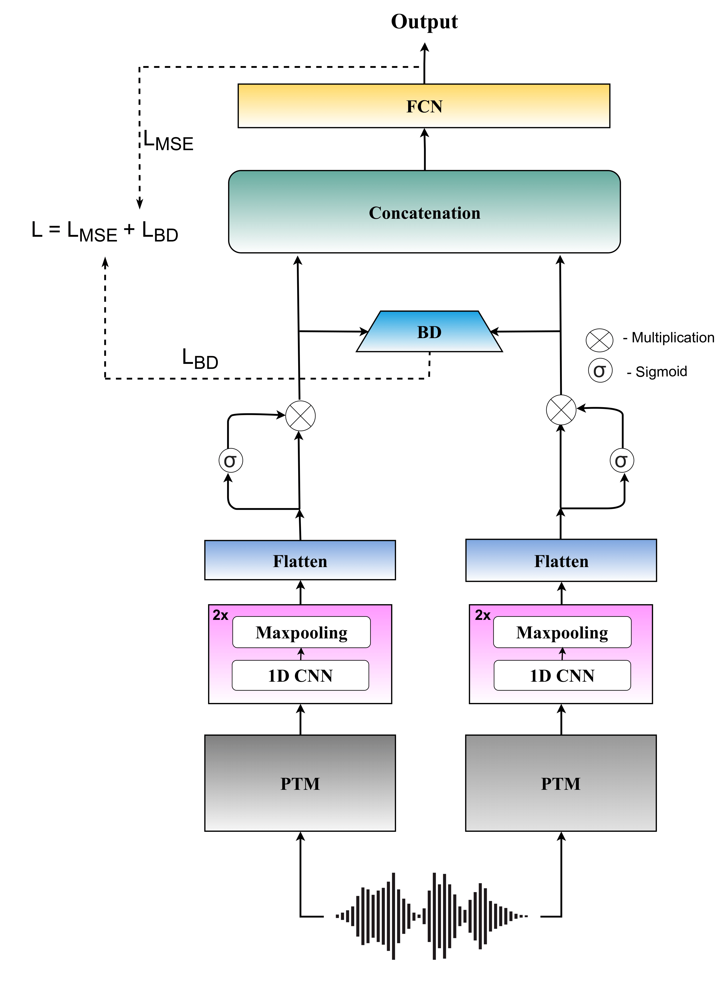

<div align="center">

# BATCH-SingMOS: Singing Voice Quality Assessment via Bhattacharyya Fusion

## Investigating the Reasonable Effectiveness of Speaker Pre-Trained Models and their Synergistic Power for SingMOS Prediction

[](https://www.isca-archive.org/interspeech_2025/phukan25d_interspeech.html)
[](https://arxiv.org/pdf/2506.02232)
[](LICENSE)
[](https://www.python.org/)
[](https://pytorch.org/)

</div>

---

## Overview

**BATCH-SingMOS** introduces BATCH (Bhattacharyya Distance), a novel fusion framework for predicting Singing Voice Mean Opinion Score (SingMOS) - a measure of how listeners rate synthesized singing quality.

The key innovation is demonstrating that **speaker recognition pre-trained models** (like x-vector and ECAPA) are exceptionally effective for capturing fine-grained vocal features in synthesized singing. By fusing these models using Bhattacharyya distance, BATCH achieves **state-of-the-art** performance.

## Paper Details

**Title**: Investigating the Reasonable Effectiveness of Speaker Pre-Trained Models and their Synergistic Power for SingMOS Prediction

**Authors**: Orchid Chetia Phukan, Girish, Mohd Mujtaba Akhtar, Swarup Ranjan Behera, Pailla Balakrishna Reddy, Arun Balaji Buduru, Rajesh Sharma

**Conference**: Interspeech 2025, pp. 3090–3094

**Paper Link**: [ISCA Archive](https://www.isca-archive.org/interspeech_2025/phukan25d_interspeech.html)

## Abstract

In this study, we focus on Singing Voice Mean Opinion Score (SingMOS) prediction. Previous research has shown the performance benefit with the use of state-of-the-art (SOTA) pre-trained models (PTMs). However, they haven't explored speaker recognition speech PTMs (SPTMs) such as x-vector and ECAPA, and we hypothesize that they will be the most effective for SingMOS prediction. We believe that due to their speaker recognition pre-training, they equip them to capture fine-grained vocal features (e.g., pitch, tone, intensity) from synthesized singing voices in a much better way than other PTMs.

Our experiments with SOTA PTMs including SPTMs and music PTMs validate the hypothesis. Additionally, we introduce a novel fusion framework, **BATCH**, that uses Bhattacharyya Distance for fusion of PTMs. Through BATCH with the fusion of speaker recognition SPTMs, we report the topmost performance compared to all individual PTMs and baseline fusion techniques as well as setting SOTA.

---

<div align="center">
    
</div>

---

## Key Innovation: BATCH Framework

### What is Bhattacharyya Distance?

Bhattacharyya distance measures the statistical distance between two probability distributions. Unlike simple averaging or concatenation, it captures the divergence between representation spaces.

### Why BATCH Works

1. **Statistical Fusion** - Treats PTM outputs as probability distributions
2. **Non-Linear Combination** - Captures complex relationships between models
3. **Principled Weighting** - Automatically weights models based on their complementarity
4. **Information Preservation** - Maintains rich representation information

### BATCH Fusion Process

```
Speaker PTM 1 (x-vector)    ┐
Speaker PTM 2 (ECAPA)        │ Extract Features
Music PTM                     │
Acoustic PTM                  ┘
         ↓
    Bhattacharyya Distance Fusion
         ↓
    SingMOS Prediction (0-5 scale)
```

---

## Pre-Trained Models Explored

### Speaker Recognition PTMs (Most Effective)
- **x-vector** - TDist-weighted speaker embedding
- **ECAPA-TDNN** - Emphasizing Channel and Phonetic Awareness

### Music & Acoustic PTMs
- **Music Information Retrieval** models
- **Acoustic feature** extractors
- **General Speech** models

---

## Quick Start

### Installation

```bash
git clone https://github.com/Helix-IIIT-Delhi/BATCH-SingMOS.git
cd BATCH-SingMOS
pip install -r requirements.txt
```

### Basic Usage

```python
from batch import BATCHFusion
from models import load_pretrained_model

# Load pre-trained models
x_vector = load_pretrained_model('x-vector')
ecapa = load_pretrained_model('ecapa-tdnn')

# Initialize BATCH fusion
fusion = BATCHFusion(models=[x_vector, ecapa])

# Extract singing audio features
features = extract_features(audio_path)

# Predict SingMOS
singmos_score = fusion.predict(features)
print(f"Predicted SingMOS: {singmos_score:.2f}")
```

---

## Results

BATCH achieves **state-of-the-art** SingMOS prediction performance:

| Method | SOTA | Key Insight |
|--------|------|------------|
| Individual PTMs | ✗ | Single models capture limited aspects |
| Baseline Fusion (Averaging) | ✗ | Simple averaging loses information |
| **BATCH (Speaker PTMs)** | ✅ | Bhattacharyya fusion + speaker models = SOTA |

### Performance Breakdown

- **Speaker PTMs**: Capture fine-grained vocal features (pitch, tone, intensity)
- **Music PTMs**: Capture musicality and expression
- **BATCH Fusion**: Harmonizes complementary information optimally

---

## Methodology

### Bhattacharyya Distance Formula

For two distributions P and Q:

```
B(P, Q) = -ln(∫√(P(x)Q(x))dx)
```

BATCH uses this to measure divergence between PTM outputs and optimize fusion weights.

### Why Speaker Models Excel

Speaker recognition models are trained to capture:
- **Pitch accuracy** - Crucial for singing
- **Vocal tone quality** - Defines voice character
- **Intensity dynamics** - Controls expressiveness
- **Timbre characteristics** - Unique voice properties

These are exactly what SingMOS evaluators assess!

---

## Repository Structure

```
BATCH-SingMOS/
├── README.md
├── LICENSE
├── requirements.txt
├── setup.py
│
├── batch/
│   ├── __init__.py
│   ├── fusion.py          # BATCH fusion framework
│   ├── distance.py        # Bhattacharyya distance
│   ├── utils.py          # Utility functions
│   └── metrics.py        # Evaluation metrics
│
├── models/
│   ├── __init__.py
│   ├── ptm_loader.py     # Load pre-trained models
│   ├── extractors.py     # Feature extraction
│   └── pretrained.py     # Model definitions
│
├── configs/
│   ├── batch_config.yaml
│   └── models_config.yaml
│
├── scripts/
│   ├── train.py
│   ├── evaluate.py
│   └── predict.py
│
├── tests/
│   └── test_fusion.py
│
└── SingMOS-1.png         # Architecture diagram
```

---

## Key Features

🎵 **Singer-Optimized** - Leverages speaker recognition expertise for vocal assessment  
🔄 **Bhattacharyya Fusion** - Principled statistical fusion framework  
🤖 **Multi-Model Ensemble** - Combines diverse pre-trained models  
📊 **SOTA Results** - State-of-the-art SingMOS prediction performance  
⚡ **Efficient Inference** - Fast computation using pre-extracted features  
🔧 **Easy Integration** - Simple API for custom applications  

---

## Citation

If you find this work useful, please consider citing us:

```bibtex
@inproceedings{phukan2025investigating,
  title={Investigating the Reasonable Effectiveness of Speaker Pre-Trained Models and their Synergistic Power for SingMOS Prediction},
  author={Phukan, Orchid Chetia and Girish and Akhtar, Mohd Mujtaba and Behera, Swarup Ranjan and Reddy, Pailla Balakrishna and Buduru, Arun Balaji and Sharma, Rajesh},
  booktitle={Proceedings of Interspeech 2025},
  pages={3090--3094},
  year={2025},
  doi={10.21437/Interspeech.2025-2227}
}
```

---

## License

MIT License - see [LICENSE](LICENSE) for details.

## Authors

- **Orchid Chetia Phukan**
- **Girish**
- **Mohd Mujtaba Akhtar**
- **Swarup Ranjan Behera**
- **Pailla Balakrishna Reddy**
- **Arun Balaji Buduru**
- **Rajesh Sharma**

---

<div align="center">

**Advancing Singing Voice Quality Assessment through Intelligent Fusion**

</div>
